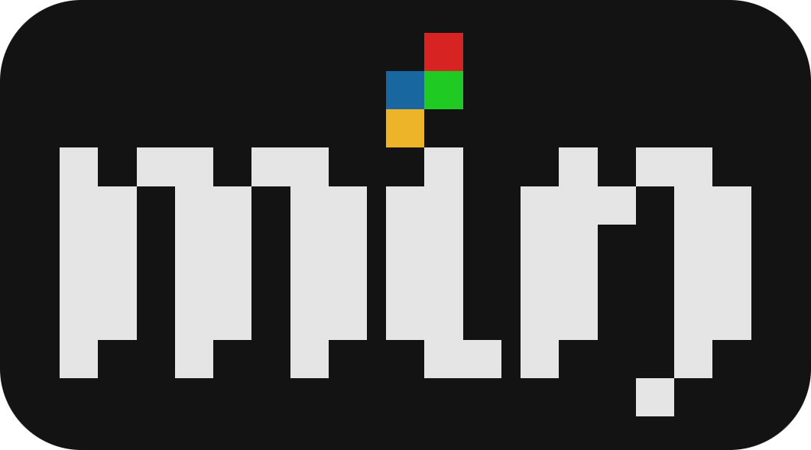
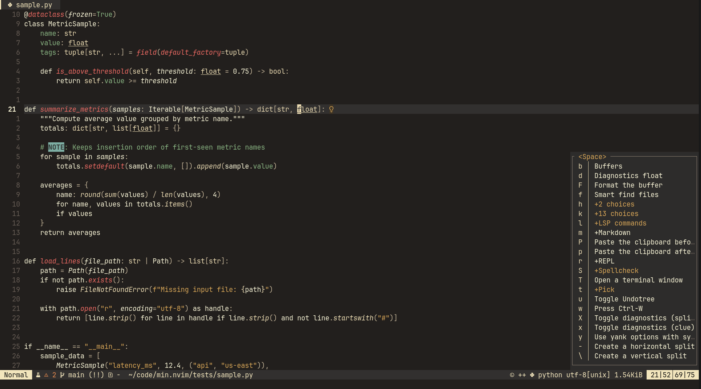
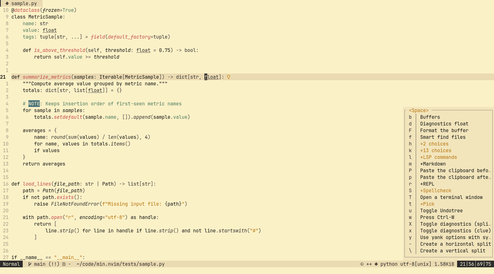
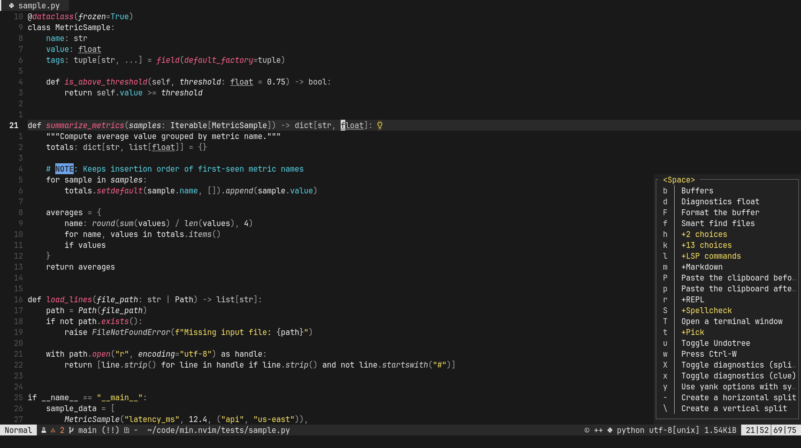
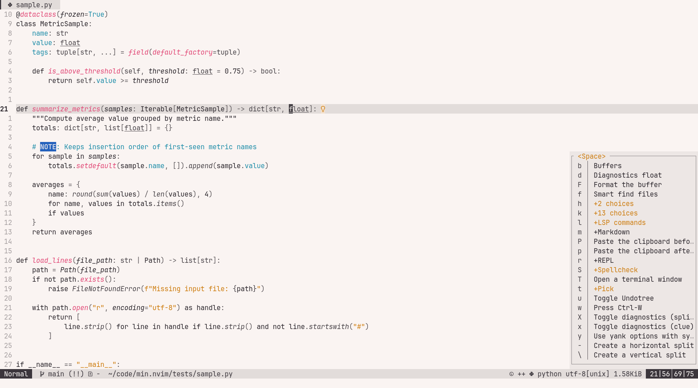
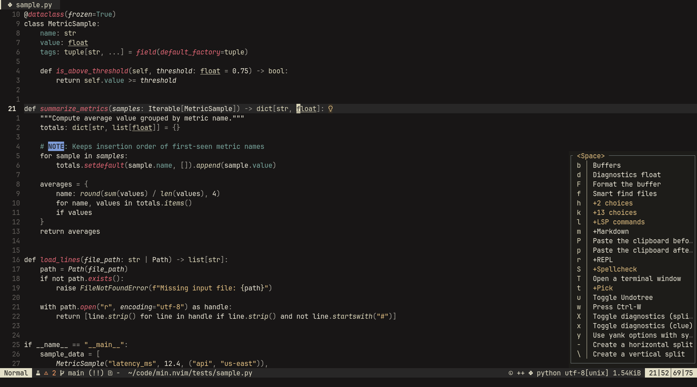
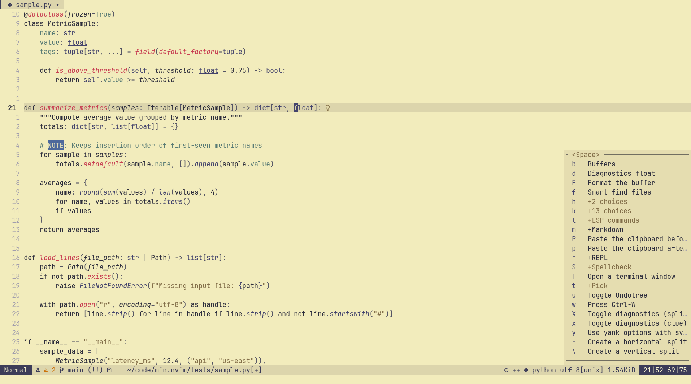

<p align="center">
    
</p>

<p align="center">
    A minimal colorscheme with several flavors, conceptually inspired by <a href="https://github.com/tonsky/sublime-scheme-alabaster">Alabaster</a>.
</p>

## Preview

<table>
  <thead>
    <tr>
      <th>Flavor</th>
      <th>Dark</th>
      <th>Light</th>
    </tr>
  </thead>
  <tbody>
    <tr>
      <td>
        <code>gruvbox</code> <em>(default)</em>
        <ul>
          <li>Based on <a href="https://github.com/sainnhe/gruvbox-material">gruvbox-material</a></li>
          <li><code>material</code> palette</li>
          <li>Warmer background</li>
        </ul>
      </td>
      <td align="center"></td>
      <td align="center"></td>
    </tr>
    <tr>
      <td>
        <code>monokai</code>
        <ul>
          <li>Based on <a href="https://github.com/loctvl842/monokai-pro.nvim">monokai-pro.nvim</a></li>
          <li><code>Spectrum</code> variant</li>
        </ul>
      </td>
      <td align="center"></td>
      <td align="center"></td>
    </tr>
    <tr>
      <td>
        <code>kanagawa</code>
        <ul>
          <li>Based on <a href="https://github.com/rebelot/kanagawa.nvim">kanagawa.nvim</a></li>
          <li><code>Dragon</code> background &amp; neutrals</li>
          <li><code>Wave</code> foregrounds &amp; accents</li>
        </ul>
      </td>
      <td align="center"></td>
      <td align="center"></td>
    </tr>
  </tbody>
</table>

## Installation

<details><summary>vim.pack</summary>

```lua
vim.pack.add("https://github.com/dybdeskarphet/min.nvim")
vim.cmd.colorscheme("min")
```

</details>

<details><summary>lazy.nvim</summary>

```lua
{
    "dybdeskarphet/min.nvim",
    config = function()
        vim.cmd.colorscheme("min")
    end,
}
```

</details>

<details><summary>mini.deps</summary>

```lua
-- Assuming that require("mini.deps").setup() call has been made
MiniDeps.add({
    source = "dybdeskarphet/min.nvim"
})
MiniDeps.now(function()
    -- Add the relevant configuration options if you want to
    vim.cmd.colorscheme("min")
end)
```

</details>

## Configuration

The default configuration settings are as follows:

```lua
require("min").setup({
	flavor = "gruvbox", -- Available values: "gruvbox", "monokai", "kanagawa"
	transparent = false, -- Sets all the major background values to 'none'
	italic_comments = false, -- Italic comments
	italic_functions = true, -- Italic functions and methods
	contrast = "low", -- Available values: "high", "low"
	theme = "dark", -- Available values: "dark", "light"
	accent = "red", -- Changes the definition (functions, structs etc.) colors. Available values: "red", "orange", "yellow", "green", "cyan", "blue", "magenta"
    semantic_highlights = true, -- Uses LSP semantic highlighting, disable this if you want the highlights of =< 0.3.1
    terminal_colors = true, -- Replaces the terminal's ANSI colors with color scheme's
    markdown_docstring = {
        python = false, -- Only available filetype for now
    }, -- Highlights docstring content as markdown
    extend = {
        todotxt = true, -- Extends todo.txt syntax highlighting with markdown_inline (only available filetype for now)
    }, -- Extends the syntax highlighting in numerous ways
	overrides = {
      -- Type = { fg = '#83a598' }, -- Hex override
      -- ['Type'] = { link = '@function.method.call' }, -- Link to another group
	},
})

-- Activates the colorscheme
vim.cmd.colorscheme('min')
```

## Themed plugins

- [mini.nvim](https://github.com/nvim-mini/mini.nvim)
  - mini.hipatterns
  - mini.statusline
  - mini.diff
  - mini.clue
  - mini.indentscope
  - mini.starter
- [MeanderingProgrammer/render-markdown.nvim](https://github.com/MeanderingProgrammer/render-markdown.nvim)
- [shellRaining/hlchunk.nvim](https://github.com/shellRaining/hlchunk.nvim)
- [lewis6991/gitsigns.nvim](https://github.com/lewis6991/gitsigns.nvim)
- [folke/flash.nvim](https://github.com/folke/flash.nvim)
- [lukas-reineke/indent-blankline.nvim](https://github.com/lukas-reineke/indent-blankline.nvim)
- [DanilaMihailov/beacon.nvim](https://github.com/DanilaMihailov/beacon.nvim)
- [m-pilia/vim-mediawiki](https://github.com/m-pilia/vim-mediawiki)
